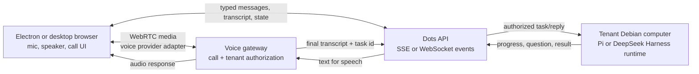

# Dots voice calls: public evidence and Coke Dots design

Updated 2026-10-11 on `feature/realtime-voice-provider`.

## What OpenAI has publicly confirmed

OpenAI's [Dots channels documentation](https://learn.chatgpt.com/docs/dots/channels) describes product behavior, not the internals of the phone call stack. A user starts a call from the Dot conversation or the Dot profile in the desktop app, may keep typing while speaking, and may hear a progress update or a question from the Dot. Ending the call closes the voice conversation while previously assigned work can continue. Calls initiated by the Dot are documented as planned after launch. The docs do not identify the codec, transport, speech-recognition model, voice model, or audio-retention policy used by Dots.

The Futurepedia V1 video at 06:26 shows the call screen with a Dot avatar/name, elapsed timer, Speaker, End, and Mute buttons. The spoken request is shown in the review video, not as a transcript inside the phone UI. John Aspinall's V2 video shows a call alongside the Dot conversation and context panel at 05:40 and 06:11, with compact microphone and hang-up controls at the conversation's upper right; at 13:58 a “Me: Call ended” event appears in the conversation. These are product observations only; the video does not reveal Dots' network or model implementation.

Sources:

- [OpenAI Dots messaging and voice documentation](https://learn.chatgpt.com/docs/dots/channels)
- [OpenAI Dots tasks and memory](https://learn.chatgpt.com/docs/dots/tasks-and-memory)
- [Futurepedia, I Tested OpenAI's New Personal Assistant Agent: DOTS](https://www.youtube.com/watch?v=V_1Vn2WfpEY), 06:26
- [John Aspinall, I Tried ChatGPT Dots: Setup, Voice Calls & Real Tasks](https://www.youtube.com/watch?v=Q9tF0R8d_Co), 05:40, 06:11, 07:12, 13:58

## Current Coke Dots call path

The default browser provider is a **chained browser voice path**. The `feature/realtime-voice-provider` branch adds an optional Qwen WebRTC speech-to-speech path:

1. The browser's Web Speech `SpeechRecognition` implementation listens to the microphone. The browser/OS speech service provides a finalized transcript; Coke Dots does not receive or persist the raw audio.
2. Each final phrase goes through the same tenant-authenticated task API as typed work. A clarification uses the existing waiting task ID and task-reply endpoint.
3. While the call remains open, the client polls `/api/state` and follows the task. The independent agent worker continues running if the call closes.
4. Browser `speechSynthesis` reads short acknowledgements, questions, and final task results. Recognition pauses during playback to reduce self-transcription.
5. Mute stops recognition; Speaker stops synthesized playback; End records the call duration and tears down the client call. The regular composer remains available.

The browser path is deterministic enough for mocked Chrome E2E and connects to the existing Pi/DeepSeek Harness task engines. It is not equivalent to a live full-duplex voice model: recognition and voice quality depend on browser support, the UI cannot cancel remote playback at the model, and polling adds delay. The current E2E injects speech through a fake browser recognizer; it does not claim live microphone or acoustic-quality coverage.

## Recommended production path for Pi and DeepSeek Harness

Keep voice as a transport/channel adapter around the existing task system. Do not move the Agent kernel out of the tenant's Debian cloud computer. The browser should own microphone permission and the call controls; the authenticated backend should own call identity, policy, event routing, and short-lived voice credentials. The tenant's Debian Agent Runtime should continue to own task execution and durable state.

Use a provider interface rather than binding the task kernel to a speech vendor:

- `SpeechInputProvider`: microphone/session setup, turn detection, transcript events, interruption events, stop/cleanup.
- `SpeechOutputProvider`: streaming audio, playback completion, interruption/cancel.
- `VoiceSessionTransport`: call ID, tenant/user authorization, and delivery of typed text and task progress.
- Existing `AgentAdapter`: receives ordinary task instructions or replies and runs inside the tenant Debian computer.

For low-latency speech-to-speech, OpenAI's public [voice-agent guide](https://developers.openai.com/api/docs/guides/voice-agents) documents a Realtime session in the browser, handling audio turns, tools, interruptions, and handoffs. The [WebRTC guide](https://developers.openai.com/api/docs/guides/voice-webrtc) sends microphone and generated audio over negotiated WebRTC media tracks, with JSON events over a data channel; a trusted server creates the session or mints a short-lived client key, while the standard API key stays server-side. OpenAI recommends WebRTC for browser/mobile Realtime clients. This is a public developer API design, **not confirmed Dots internals**, and it introduces a separate voice provider and billing profile from the user's Pi/DeepSeek task kernel.

For provider flexibility and direct compatibility with Pi/DeepSeek Harness, a **chained voice pipeline** remains a valid option: speech-to-text → normal tenant task/reply → text-to-speech. OpenAI's guide describes this as the path for inspecting or transforming intermediate text and replacing each stage independently. It is easier to audit and replay in E2E, though it has more latency than speech-to-speech. The Qwen branch instead uses a realtime voice model for turn detection, transcription, short acknowledgements, and spoken task updates; it still delegates durable work to the existing Agent adapter.

Security and lifecycle requirements:

- Bind every call, transcript, task, and stream to the authenticated user and tenant; never trust a client-supplied tenant ID.
- Keep long-lived provider keys on the backend. If a Realtime provider is selected, issue only its short-lived client credential/session from a tenant-authorized backend endpoint.
- Don't store audio by default. Store transcript only through the existing task/conversation record and make the retention rule explicit.
- End-call cleanup must stop local tracks, audio playback, event subscriptions, and task polling. It must not cancel the separate agent job unless the user explicitly stops that task.
- Model tests with deterministic audio/transcript fixtures; run a separate manual Chrome/Electron microphone check for permissions, echo cancellation, interruption, network loss, and real device playback.

## UI evidence implementation

The 06:26 source frame is a compressed phone-in-video composite, so these dimensions are relative to the visible handset, not original CSS pixels. The V1 call surface is roughly 0.49:1 width-to-height; it has a graphite bezel, blue/gray gradient, status bar and notch, ring-style Dot avatar/name, large timer, one expand control, and three bottom controls ordered Speaker → End → Mute. V2 shows a separate compact call state beside the conversation: a microphone toggle and red hang-up button at the conversation's upper right. Coke Dots models both observed visual states, selecting the compact state for an active desktop conversation and the handset for standalone call entry; that selection rule is inferred because the footage does not show all entry points in both layouts. Visible transcript/task details remain in the underlying conversation; screen-reader updates retain transcript and task state without adding a text card that is absent from the reference frame.

The expand button is an implementation interaction inferred from its visible icon. No source video frame demonstrates its resulting state; it is marked as unverified rather than treated as a confirmed Dots behavior.

## Provider choice: Qwen first, Volcano as a measured alternative

Both Qwen and Volcano offer integrated realtime speech-to-speech models. A separate TTS service is **not required** for the first live conversation: the realtime model can listen, detect turns, and return speech. Keep standalone streaming TTS as an optional adapter when exact playback of Agent text, voice selection, or vendor failover requires it.

| Provider | Relevant official capability | Coke Dots fit |
|---|---|---|
| Alibaba Model Studio Qwen | `qwen3.8-omni-flash-realtime` supports browser WebRTC and server WebSocket. WebRTC carries audio on media tracks and text/events on a DataChannel; an authenticated AppServer exchanges SDP so the long-lived API key stays server-side. Qwen-Audio Realtime also documents VAD/push-to-talk modes and Function Calling. | Best first integration because the existing voice feature branch already implements the WebRTC negotiation and task handoff. Requires a matching DashScope API key and workspace ID for Beijing or Singapore. |
| Volcano Engine / Doubao | The standalone end-to-end realtime speech API uses a streaming WebSocket. Volcano's RTC `StartVoiceChat` path also offers pure S2S and a hybrid mode that sends tool-oriented turns to its configured LLM. The documented hybrid `LLMConfig` is limited to Volcano Ark models. | A credible Mandarin voice-quality/latency comparison. Use a separate provider adapter and server-side credential handling; route Pi/DSH through Coke Dots' own authorized task bridge rather than assuming the managed Ark model can host those kernels. |

Sources: [Qwen Realtime overview](https://help.aliyun.com/zh/model-studio/realtime), [Qwen WebRTC connection](https://help.aliyun.com/zh/model-studio/realtime-webrtc-access), [Qwen Audio Realtime and Function Calling](https://help.aliyun.com/zh/model-studio/qwen-audio-realtime-user-guides), [Volcano end-to-end realtime speech integration](https://docs.volcengine.com/docs/real_time_communication/Accessend-to-endreal-timespeechlargemodel?lang=zh), [Doubao Realtime API](https://docs.volcengine.com/docs/DoubaoVoice/End-to-endreal-timespeechlargemodelAPIaccessdocument?lang=zh).

**Recommendation:** validate Qwen end to end first, then benchmark Volcano behind the same provider interface if a Volcano credential is available. Qwen is the lower-risk first step for the current browser call because its WebRTC path is already implemented. This is an implementation choice based on fit and existing code, not a claim that Qwen is faster or sounds better; that requires a same-device, same-network Mandarin test.

## Voice-to-Agent handoff and perceived latency

Keep the voice loop responsive while the personal Agent does durable work:

1. The browser opens an authenticated call and streams microphone audio over WebRTC. Qwen/Volcano handles VAD, transcription, barge-in, and a short acknowledgement such as “收到，我开始查了”.
2. On each finalized utterance, the app sends a `callId` and unique `turnId` to the Coke Dots API. The server derives tenant and user from the session, deduplicates the turn, then creates a task or replies to that user's waiting task.
3. The tenant's Debian cloud computer runs Pi or DeepSeek Harness. The call is only a channel; it does not replace the Agent runtime or its task state.
4. The task emits `accepted`, `working`, `needs_input`, `approval_required`, `done`, or `failed` events. Send these to the conversation and active call over SSE/WebSocket. Speak short progress or clarification messages as they arrive; do not hold the voice response open until a long task finishes.
5. Ending the call closes media but leaves the task running. If the user asks a follow-up during the call, reply to the existing waiting task rather than creating a duplicate.

Treat provider Function Calling as an intent signal, not authorization. Only the Coke Dots server should execute a `create_task`/`reply_to_task` action after deriving tenant ownership, checking task state and action rules, applying idempotency, and requiring approval where needed. Never accept a tenant ID, tool permission, or arbitrary tool payload supplied by the browser or voice model as authority.

The current Qwen branch already sends finalized Qwen transcripts into the existing task/reply API and has the voice model read Agent status updates. It currently polls task state while the call is active; an SSE/WebSocket event stream is the next latency improvement. Its acknowledgement is intentionally short so a long Agent task does not block the call. Do not present that acknowledgement as task progress or completion.

For validation, record separate timings for utterance end → acknowledgement audio, transcript final → task accepted, and Agent event → spoken update. Set an initial product target of a brief acknowledgement beginning within about one second after the user finishes speaking, then measure p50/p95 on the same browser and network. This is a Coke Dots acceptance target, not a provider guarantee. Also test barge-in, muted input, duplicate turn delivery, task clarification, approval, provider disconnect, tenant isolation, and ending a call while the task continues. The E2E mock can prove task routing and UI states; only a live provider session can prove real microphone quality and actual round-trip latency.

## Qwen Realtime implementation

The `feature/realtime-voice-provider` branch adds an optional Qwen WebRTC speech-to-speech provider alongside the browser SpeechRecognition fallback. Set `DOTS_VOICE_PROVIDER=qwen`, `DOTS_QWEN_API_KEY` (or the standard `DASHSCOPE_API_KEY`), `DOTS_QWEN_WORKSPACE_ID`, and `DOTS_QWEN_REGION=beijing|singapore` on the Coke Dots server. These are shared instance settings, not tenant workspace secrets. The browser only receives the provider's configured state and the SDP answer; it never receives the API key.

The call UI creates an authenticated, user-owned call record, asks the browser for microphone permission, negotiates SDP through `POST /api/voice-calls/:id/realtime-session`, and sends microphone audio over WebRTC. A Qwen transcription-completed event is submitted through the existing task/reply path; that task continues to execute in the tenant's configured Agent runtime. The call follows durable task state and sends waiting questions and final task results back as text for Qwen to speak. Ending the call closes the peer connection and channels and stops local microphone tracks without stopping the underlying Agent task.

The real-time provider's generated response is constrained to a brief Chinese acknowledgement; task answers and progress come from the tenant Agent. Qwen VAD still produces its own short turn response before a persistent task is created, so this is a low-latency voice front end around the existing Agent, not native Agent function calling. A future provider adapter can replace this signaling/session implementation without changing the task protocol.

Provider configuration, SDP validation, key secrecy, upstream error redaction, and endpoint selection have deterministic tests. No live Qwen call has been verified in this branch because a DashScope key and workspace ID have not been configured; the prior DeepSeek key cannot authenticate to Qwen. Qwen WebRTC uses the region-specific workspace endpoint and a server-side Bearer key as described in [Alibaba Cloud's official realtime guide](https://help.aliyun.com/zh/model-studio/realtime). Its browser path is documented for low-latency audio over WebRTC with server-side VAD and text events over the data channel. The model supports Chinese audio transcription/output and function calling according to the [official model capabilities](https://help.aliyun.com/zh/model-studio/qwen3-8-omni-flash-realtime).
